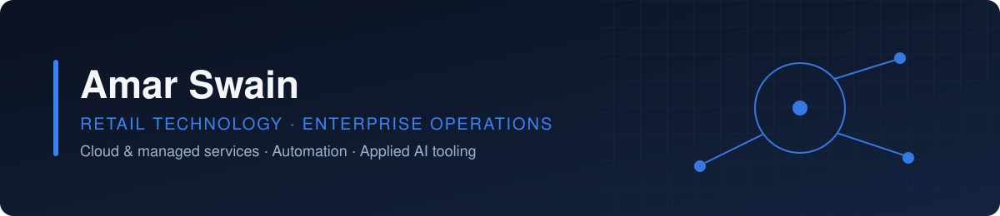

  
  

---

### About

I work in **retail technology**, helping enterprise customers run reliable, well-governed technology operations. On GitHub I publish the internal tooling I build along the way — operations dashboards, automation for managed services, and practical AI utilities that remove manual work from day-to-day delivery.

### Focus areas

| | |
|---|---|
| **Managed services operations** | Visibility, ticket and SLA tracking, and operational reporting for MSP teams |
| **Cloud & infrastructure** | Azure, deployment automation, and infrastructure-as-configuration |
| **Applied AI** | Local speech-to-text, meeting intelligence, and AI-assisted productivity tools |
| **Retail technology** | Systems and processes that keep retail operations running at scale |

### Featured projects

| Project | What it does | Stack |
|---|---|---|
| [**MSP Ops Center**](https://github.com/swainamar/MSP_Ops_Center) | Central operations console for managed-services delivery teams | Python |
| [**MeetingNoteTaker**](https://github.com/swainamar/MeetingNoteTaker) | Windows meeting recorder with local transcription (incl. Odia), speaker identification, AI notes and screen recording | Python · Whisper |

### Tech stack

  
  
  
  
  
  

### Get in touch

Open to conversations on retail technology, managed services, and practical AI in enterprise operations. Feel free to open an issue on any of my repositories.

Views and code here are my own and do not represent my employer.
